# FotoParada

## Descripción de la aplicación

### Nombre

**FotoParada**

### Problema que busca resolver

Las fotos terminan mezcladas en la galería del teléfono y con el tiempo cuesta
recordar dónde se tomaron. Tampoco es fácil descubrir lugares cercanos que
valga la pena fotografiar ni ver cómo ha cambiado un sitio a lo largo de los
años.

### Público objetivo

Personas que usan redes sociales y disfrutan tomar fotos: quienes quieren
organizar sus recuerdos por lugar, viajeros y aficionados a la fotografía que
buscan nuevos sitios.

### Descripción general

FotoParada es una aplicación móvil que permite organizar, descubrir y compartir
fotografías según el lugar donde fueron tomadas. En un mapa interactivo se
exploran las fotos de cada ubicación; además se pueden guardar lugares en
colecciones, participar en retos fotográficos, hacer check-in con el GPS y
comparar cómo se veía un lugar en distintas épocas.

## Funcionalidades

| Funcionalidad | Qué permite |
| --- | --- |
| Cuentas | Registrarse, iniciar y cerrar sesión, y recuperar la contraseña por correo. |
| Cámara y galería | Tomar una foto o elegirla de la galería para publicarla con título, descripción, categoría y privacidad. |
| Geolocalización (GPS) | Ubicar cada foto con los datos de la imagen, la posición actual o un punto elegido en el mapa, y obtener el nombre del lugar. |
| Mapa interactivo | Ver marcadores donde se tomaron las fotos (las cercanas se agrupan), buscar lugares y filtrar por categoría: naturaleza, comida, arte, eventos, lugares y mascotas. |
| Descubre cerca de ti | Ver las fotos públicas a menos de 5 km, ordenadas por distancia. |
| Explorar | Recorrer las fotos públicas más recientes. |
| Fotos por lugar | Al tocar el marcador de tu ubicación, ver las fotos tomadas a menos de 200 m, recientes o populares. |
| Reacciones y comentarios | Reaccionar (❤️ 😍 😮 👏) y comentar en las fotos. |
| Compartir | Enviar o copiar un enlace de Google Maps u OpenStreetMap, con la foto opcionalmente. |
| Check-in fotográfico | Validar con el GPS que estás a menos de 150 m de un punto y subir una foto desde ahí. |
| Retos fotográficos | Crear retos con categoría, cantidad de fotos, plazo y lugar opcional, y participar con fotos propias. |
| Colecciones | Guardar fotos y lugares en **Quiero visitar**, **Mis viajes** o colecciones propias, con notas personales. |
| Línea de tiempo | Ver las fotos de un lugar agrupadas por año. |
| Comparar épocas | Comparar una foto antigua con una reciente con un deslizador o lado a lado. |
| Privacidad | Marcar cada foto como pública, para amigos o privada. |
| Editar y eliminar | Gestionar las fotos publicadas. |

## Pantallas

### Principales (barra de navegación)

| Mapa (inicio) | Colecciones (Guardado) | Perfil |
| :---: | :---: | :---: |
| 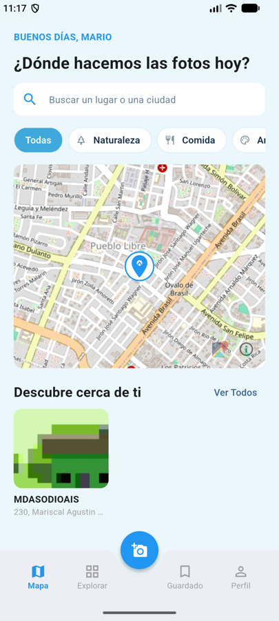 |  | 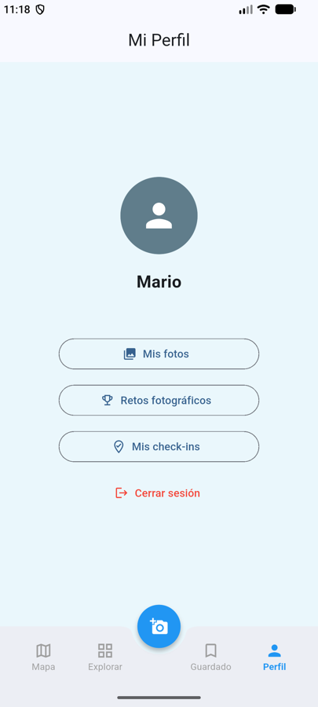 |
| Saludo, buscador de lugares, filtros por categoría, mapa y fotos cercanas. | Colecciones predeterminadas y personalizadas, con su cantidad de elementos. | Datos del usuario y accesos a sus fotos, retos y check-ins. |

La cuarta pestaña, **Explorar**, muestra las fotos públicas recientes con su
lugar y sus reacciones.

### Fotos y mapa

| Mapa a pantalla completa | Subir foto | Mis fotos |
| :---: | :---: | :---: |
| 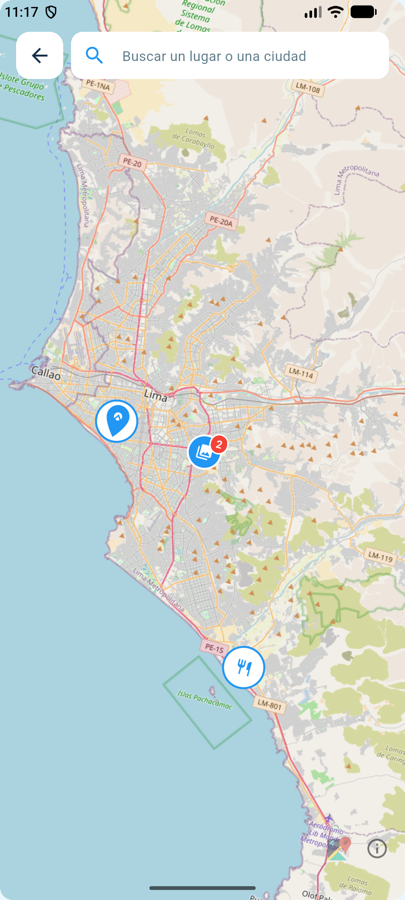 | 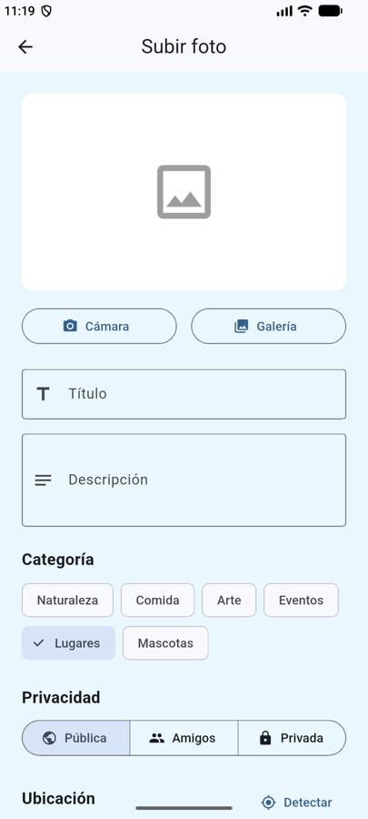 | 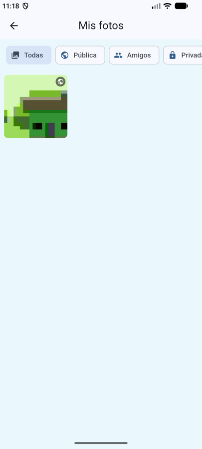 |
| Marcadores por categoría y marcadores agrupados con el número de fotos. | Cámara o galería, título, descripción, categoría, privacidad y ubicación. | Cuadrícula de fotos propias con filtro por privacidad. |

### Retos y check-in

| Retos fotográficos | Crear reto | Mis check-ins |
| :---: | :---: | :---: |
| 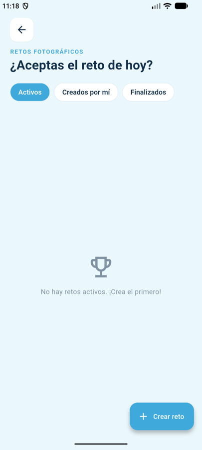 | 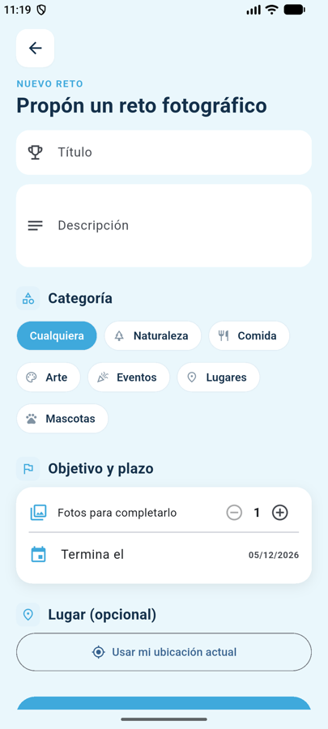 | 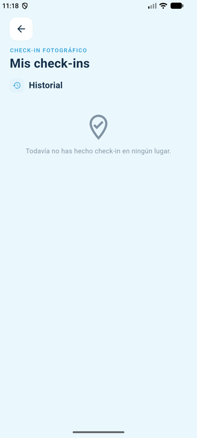 |
| Retos activos, creados por mí y finalizados. | Título, descripción, categoría, objetivo, plazo y lugar. | Historial de lugares validados con GPS. |

### Todas las pantallas

| Pantalla | Archivo (en `fotoparada/lib/view/`) | Descripción |
| --- | --- | --- |
| Inicio de sesión | `login_view.dart` | Acceso con correo y contraseña. |
| Registro | `register_view.dart` | Crea una cuenta con nombre, correo y contraseña. |
| Recuperar contraseña | `forgot_password_view.dart` | Envía un enlace para restablecer la contraseña. |
| Principal | `main_view.dart` | Barra con **Mapa**, **Explorar**, **Guardado** y **Perfil**, y botón para subir fotos. |
| Mapa (inicio) | `Map/map_home_view.dart` | Buscador, filtros, mapa y **Descubre cerca de ti**. |
| Mapa a pantalla completa | `Map/map_full_screen_view.dart` | Mapa navegable; cada marcador abre sus fotos. |
| Explorar | `feed_view.dart` | Feed de fotos públicas. |
| Detalle de ubicación | `location_detail_view.dart` | Fotos cercanas al punto, recientes o populares; permite guardarlo y ver su línea de tiempo. |
| Subir foto | `upload_photo_view.dart` | Publica una foto nueva. |
| Mis fotos | `my_photos_view.dart` | Fotos propias; permite eliminarlas manteniéndolas presionadas. |
| Editar foto | `edit_photo_view.dart` | Cambia los datos de una foto o la elimina. |
| Detalle de foto | `photo_interactions_view.dart` | Foto, reacciones, comentarios y accesos a guardar, línea de tiempo, check-in y compartir. |
| Compartir ubicación | `share_location_view.dart` | Genera y comparte el enlace. |
| Check-in | `checkin_view.dart` | Valida la posición y muestra el historial. |
| Retos | `challenges_view.dart` | Lista de retos. |
| Detalle de reto | `challenge_detail_view.dart` | Progreso, participantes y fotos enviadas. |
| Crear reto | `create_challenge_view.dart` | Formulario de un reto nuevo. |
| Perfil | `profile_view.dart` | Datos de la cuenta y cierre de sesión. |
| Colecciones | `collections_view.dart` | Crea, renombra y elimina colecciones. |
| Detalle de colección | `collection_detail_view.dart` | Lugares y fotos guardados; notas, mover, quitar y **Ya lo visité**. |
| Línea de tiempo | `timeline_view.dart` | Fotos por año, orden y filtro **Mis recuerdos**. |
| Comparar épocas | `compare_photos_view.dart` | Antes y después con el tiempo transcurrido. |
| Guardar en colección | `widgets/recuerdos_widgets.dart` | Hoja inferior para elegir colecciones. |

## Flujo de navegación

Al abrir la app, si hay una sesión guardada se entra a la pantalla principal; si
no, al inicio de sesión.

### Acceso y pestañas

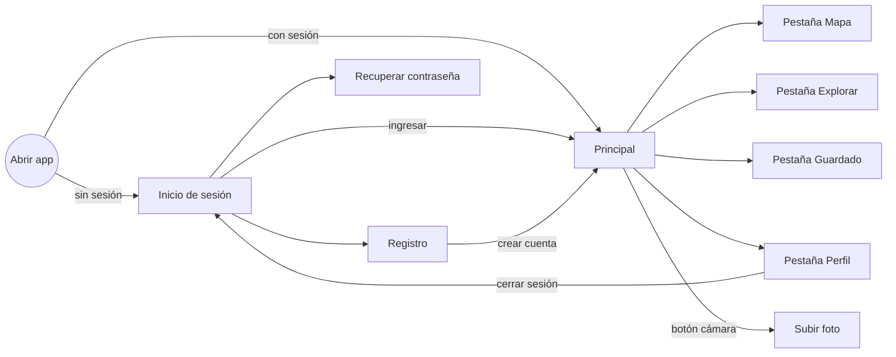

### Mapa, fotos y recuerdos

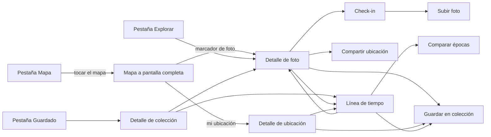

### Perfil y retos

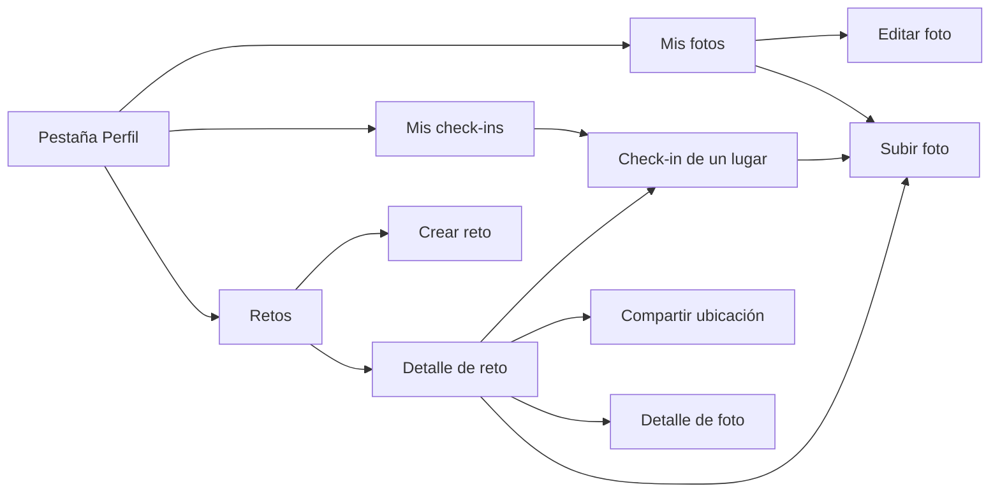

## Tecnologías utilizadas

| Tecnología | Uso |
| --- | --- |
| [Flutter](https://flutter.dev) y Dart | Aplicación móvil para Android, con Material 3 |
| Firebase Authentication (`firebase_auth`) | Cuentas de usuario |
| Cloud Firestore (`cloud_firestore`) | Base de datos y reglas de seguridad |
| [ImgBB](https://api.imgbb.com) (`http`) | Alojamiento de las imágenes; en Firestore se guarda solo el enlace |
| [OpenStreetMap](https://www.openstreetmap.org) (`flutter_map`, `latlong2`) | Mapas y cálculo de distancias |
| [geocode.maps.co](https://geocode.maps.co) | Búsqueda de lugares y nombre a partir de coordenadas |
| `geolocator` | Posición GPS |
| `image_picker` | Cámara y galería |
| `native_exif` | Ubicación y fecha guardadas en la foto |
| `image` | Compresión antes de subir |
| `share_plus` | Menú de compartir del sistema |
| `intl`, `flutter_localizations` | Fechas y textos en español |
| `flutter_test`, `integration_test`, `fake_cloud_firestore` | Pruebas |
| Git y GitHub | Control de versiones con ramas por integrante integradas en `dev` y luego en `main` |

## Arquitectura

La app sigue **MVVM** y separa la interfaz, la lógica y el acceso a datos
(código en `fotoparada/lib/`):

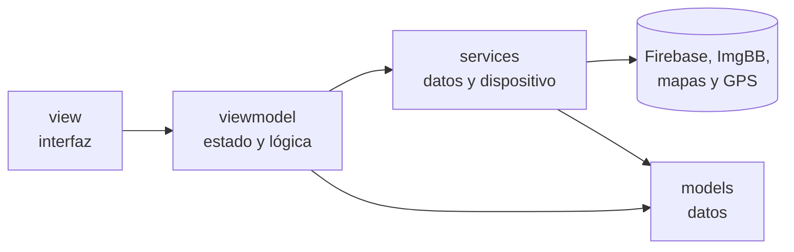

| Carpeta | Responsabilidad |
| --- | --- |
| `view/` | Pantallas y widgets. Escuchan a su viewmodel. |
| `viewmodel/` | Estado y lógica de las pantallas (`ChangeNotifier`). |
| `services/` | Acceso a Firebase, APIs externas y funciones del teléfono. |
| `models/` | Datos y utilidades puras. |
| `routes/` | Rutas con nombre de la aplicación. |

## Instalación y ejecución

Los pasos para configurar las claves de las APIs, las reglas e índices de
Firestore están en [fotoparada/README.md](fotoparada/README.md). En resumen,
desde la carpeta `fotoparada`, con `claves.json` ya creado:

```bash
flutter pub get
flutter run --dart-define-from-file=claves.json
```

Las pruebas se ejecutan con `flutter test`.

## Limitaciones conocidas

- Todavía no hay un sistema de amigos: las fotos **para amigos** hoy solo las ve
  su autor.
- **Detalle de ubicación** identifica el punto por sus coordenadas, no por el
  nombre del lugar.
- La aplicación está configurada para Android.
