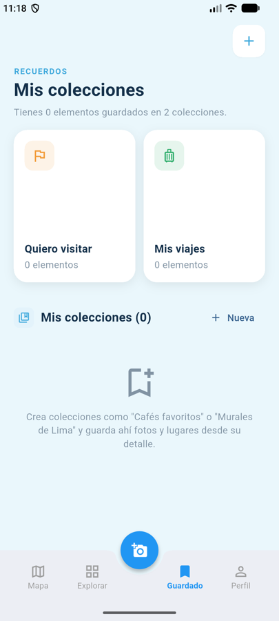
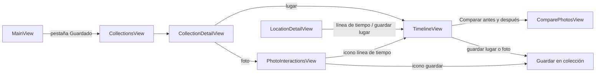

# FotoParada

## Descripción de la aplicación
### Nombre
- FotoParada
### Problema que busca resolver
- Organización de galería de fotos y recordar los lugares donde se tomaron o descubrir nuevos lugares donde tomar fotos
### Público objetivo
- Personas que usan redes sociales
### Descripción general
- FotoParada es una aplicación que permite organizar, descubrir y compartir fotografías según el lugar donde fueron tomadas. A través de un mapa interactivo, los usuarios pueden explorar fotos de diferentes ubicaciones, guardar sus lugares favoritos, descubrir nuevos sitios para fotografiar y consultar cómo han cambiado los lugares a lo largo del tiempo.

## Funcionalidades
- Mapa interactivo: mostrar marcadores según la ubicación donde se tomaron las fotos.
- Fotos por ubicación: al seleccionar un marcador, visualizar las fotos tomadas en ese punto.
- Subir una foto: el usuario puede tomar una foto o seleccionar una de su galería y asociarla automáticamente a su ubicación.
- Feed por ubicación: al entrar a un punto, ver las fotos más recientes tomadas allí.
- Filtros del mapa: filtrar por categorías como naturaleza, comida, lugares, eventos, arte, mascotas, etc.
- Fotos populares: destacar las fotos que han recibido más interacciones.
- Línea de tiempo: visualizar cómo ha cambiado un lugar mediante fotos tomadas en diferentes fechas.
- Comparar épocas: mostrar fotos antiguas y recientes del mismo lugar.
- Modo exploración: mostrar lugares cercanos que tienen muchas fotos o que el usuario todavía no ha descubierto.
- Check-in fotográfico: al llegar físicamente a un lugar, desbloquear la posibilidad de añadir una foto.
- Colecciones: guardar lugares o fotos favoritas en colecciones como “Lugares que quiero visitar” o “Mis viajes”.
- Retos fotográficos: crear desafíos como “encuentra un mural y fotografíalo” o “sube una foto desde este punto”.
- Comentarios/reacciones: permitir interacciones sencillas sobre las fotos, sin necesidad de construir una red social completa.
- Compartir ubicación/foto: generar un enlace para compartir un punto específico del mapa.
- Privacidad: permitir que una foto sea pública, visible solo para amigos o privada.
- Eliminar/editar: gestionar las fotos que el usuario haya publicado.

## Pantallas

### Recuerdos y organización (Integrante 4)

| Pantalla | Archivo | Qué hace |
| --- | --- | --- |
| Colecciones (pestaña **Guardado**) | `lib/view/collections_view.dart` | Muestra las colecciones predeterminadas **Quiero visitar** y **Mis viajes** (se crean solas la primera vez) y las colecciones personalizadas. Permite crear, renombrar y eliminar colecciones. |
| Detalle de colección | `lib/view/collection_detail_view.dart` | Lista los lugares y las fotos guardados. Desde aquí se abre la línea de tiempo de un lugar, se agrega una nota personal, se mueve un elemento a otra colección o se quita. En **Quiero visitar**, el botón ✓ ("Ya lo visité") pasa el lugar a **Mis viajes**. |
| Línea de tiempo (`TimelineView`) | `lib/view/timeline_view.dart` | Fotos de un lugar ordenadas por fecha de toma y agrupadas por año, con un resumen (cantidad, periodo y años de recuerdos). Se puede invertir el orden y filtrar solo **Mis recuerdos** (incluye mis fotos privadas o de amigos). |
| Comparar épocas (`ComparePhotosView`) | `lib/view/compare_photos_view.dart` | Compara una foto antigua con una reciente del mismo lugar con un **deslizador antes/después** o **lado a lado**, e indica el tiempo transcurrido entre ambas ("3 años y 2 meses"). Por defecto elige la más antigua y la más reciente. |
| Guardar en colección (hoja inferior) | `lib/view/widgets/recuerdos_widgets.dart` | Marca o desmarca en qué colecciones se guarda una foto o un lugar, o crea una colección nueva al momento. |

<!-- Capturas: guardar en docs/capturas/ y reemplazar esta línea, por ejemplo:
  -->

**Flujo de navegación del módulo**

**Arquitectura (MVVM, igual que el resto de la app)**

- `models/coleccion_model.dart`, `models/linea_tiempo.dart`: datos y utilidades puras (agrupar por año, tiempo entre fechas).
- `services/coleccion_service.dart`, `services/recuerdos_service.dart`: único acceso a Firestore (transacciones para que el contador de cada colección no se desincronice).
- `viewmodel/*_viewmodel.dart`: estado y lógica de cada pantalla (`ChangeNotifier`).
- `view/*_view.dart`: solo interfaz, escuchan al viewmodel con `ListenableBuilder`.
- Reglas: bloque `colecciones` en `fotoparada/firestore.rules` (cada usuario solo lee y modifica sus colecciones).
- Pruebas: `test/linea_tiempo_test.dart`, `test/coleccion_service_test.dart`, `test/recuerdos_views_test.dart` (con `fake_cloud_firestore`).
